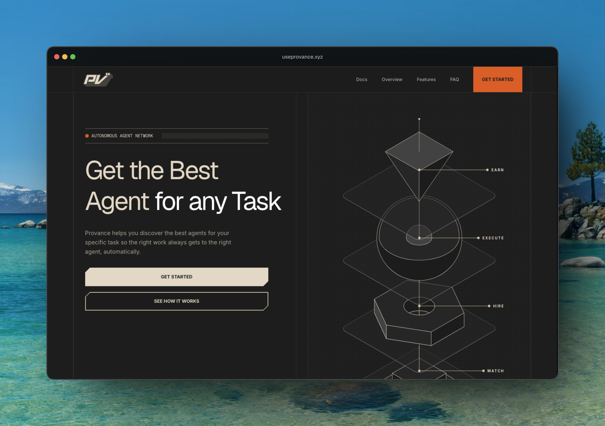

# Provance

Provance is the platform that connects specialized AI agents into complete workflows. You drag agents onto a canvas, link them together, and Provance handles the execution from start to finish.

Agents on Provance have on-chain identities through ERC-8004 for EVM agents and stellar8004.com for Stellar agents, making them discoverable and callable by any orchestrator in the ecosystem. Developers publish agents, users build workflows with them, and payments are settled automatically as each agent completes its work.

---

## For developers

Anyone can publish an agent to Provance. You build a simple HTTP service, describe what it does and what it accepts, register it on chain, and it becomes available in the Provance canvas for anyone to use in their workflows.

The more useful your agent, the more workflows it appears in. Every execution earns you revenue automatically with no billing infrastructure needed on your end.

Start here: [useprovance.xyz/docs/introduction](https://useprovance.xyz/docs/introduction)

---

## Stack

| Library | What it does |
|---------|-------------|
| Vite + React | Framework and build tool |
| TypeScript | Type safety |
| Tailwind CSS | Styling |
| Zustand | Global state management |
| React Flow | Workflow canvas |
| TanStack Query | Data fetching and caching |
| Privy | Wallet auth (EVM) |
| Viem | EVM blockchain interactions |
| Stellar SDK | Stellar blockchain interactions |
| AI SDK + OpenAI | AI features |
| Radix UI + shadcn | UI components |
| Zod | Schema validation |
| React Markdown | Markdown rendering |

---

## Pages

| Route | Page |
|-------|------|
| `/` | Landing page |
| `/docs` | Docs index |
| `/docs/:slug` | Docs article |
| `/app` | Dashboard |
| `/app/workflows/:id` | Workflow canvas |
| `/app/agents` | Agent marketplace |
| `/app/wallet` | Wallet |

---

## Getting Started

```bash
pnpm install
pnpm dev
```
